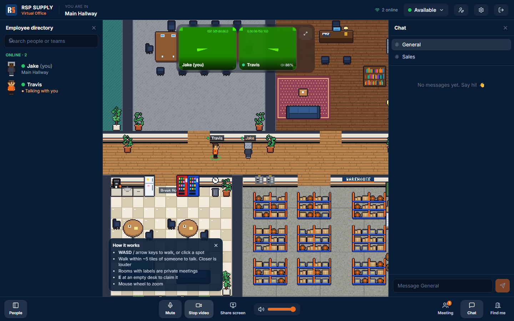

# RSP Virtual Office

An 8-bit RSP Supply office in the browser. Employees walk around as pixel-art characters. Walk up to
a coworker and your camera and microphone connect automatically; walk away and the conversation fades
out. Private meeting rooms, an employee directory, statuses, chat and screen sharing are included.

Anyone with the link can open the site, type their name, pick a character and walk in (like JustMafia).
An optional passcode keeps strangers out.



## Status

| Feature | Built | Tested |
|---|---|---|
| Name-based join, session cookie, optional passcode / email-domain gate, admin code | ✅ | automated (server test) |
| Pixel-art office: Sales, SDR, Quoting & Ops, Warehouse & Shipping, Lobby, Break Room, Conference, Management, Ops Meeting Room, two 1:1 booths | ✅ | visual (screenshots) |
| Collision with walls and furniture, WASD/arrows, click-to-walk path-finding, camera follow, zoom | ✅ | automated (browser) |
| Real-time multiplayer positions (server-validated) | ✅ | automated (server + browser) |
| **Proximity video + audio (WebRTC)**: auto connect, distance-based volume, auto disconnect | ✅ | automated (2 real browsers, fake cam/mic) |
| Walls block conversations; Do Not Disturb blocks auto-conversations | ✅ | automated (server test) |
| Private rooms: everyone inside connected, outsiders not; room lock; capacity | ✅ | automated |
| Mute, camera off, screen share | ✅ | automated (browser) |
| Avatar customisation (skin, hair style/colour, shirt, pants, shoes, 8 accessories), 4-direction walk animation | ✅ | visual |
| Statuses, auto "In a Meeting" in rooms, directory with locate / walk to / wave / message | ✅ | partly automated |
| Chat: General, department channels, DMs, history, emoji reactions, unread badges, desktop notifications | ✅ | automated (server test) |
| Desk claiming (E key) + admin desk assignment; you start at your desk | ✅ | manual only |
| Admin: roles, remove/restore access, delete, departments, desks, room settings, sign text, proximity ranges, avatar/name permissions | ✅ | manual only |
| Device selection (mic, camera, speakers) | ✅ | manual only |
| Reconnect: 10 s grace period, calls rebuilt automatically, ICE restart on network change | ✅ | partly automated |
| Test across **different networks** | ⚠️ | **not yet tested**: needs the deployed site and two people (see below). Some corporate networks need a TURN server. |
| LiveKit / SFU for large groups | ❌ | Not built. Uses peer-to-peer mesh, fine for conversations up to ~8 people. |
| Microsoft Entra ID SSO, email verification | ❌ | Not built. Names are self-entered; use `OFFICE_PASSCODE` and/or `ALLOWED_EMAIL_DOMAINS`. |

Not production-hardened: there is no email verification, so a person can type any name. Treat it as an internal tool behind a passcode.

## Run it locally

Requires Node.js 20+.

```bash
npm install
npm run dev          # server on :3001, client on http://localhost:5173 (hot reload)
```

Open http://localhost:5173 in two different browsers (or one normal and one private window). Each
window is a separate employee. With no `ADMIN_CODE` set, the first person to join becomes admin.

Production-style single server:

```bash
npm run build && npm start      # http://localhost:3001
```

## Put it online (Render, same as JustMafia)

1. Push this folder to a GitHub repository.
2. render.com → **New → Blueprint** → pick the repo → **Apply**. `render.yaml` sets everything up.
3. Open the `https://….onrender.com` address. Render provides HTTPS, which browsers require for cameras and microphones.
4. In Render → service → **Environment**, copy the generated `ADMIN_CODE`. On the join screen, click "I have an admin code" and paste it.
5. Optional but recommended:
   - `OFFICE_PASSCODE`: people must type it to enter.
   - `ALLOWED_EMAIL_DOMAINS=rspsupply.com`: only company emails.
   - `DATABASE_URL`: a free Postgres database (e.g. [Neon](https://neon.tech)). **Without it, the free plan
     wipes profiles, chat and desks on every restart/redeploy** (people just re-enter their name; the join
     screen remembers it in their browser).
   - TURN server (`TURN_URLS`, `TURN_USERNAME`, `TURN_CREDENTIAL`): needed when someone's firewall blocks
     direct connections (symptom: they appear nearby but the video tile stays "connecting"). Hosted options:
     Metered.ca, Twilio Network Traversal, Cloudflare Realtime TURN; or self-host coturn (`TURN_SECRET`).

Free-plan limits: the server sleeps after 15 minutes without visitors (the next visit takes about a minute).

### Inviting RSP Supply employees

Send the site link (and the passcode, if you set one). That's it. Admins see the link under **Admin → Invite people**.
Use **Admin → Employees** to make managers/admins, assign desks and departments, or remove someone's access.

## Testing

Automated:

```bash
npm test                          # server: proximity, walls, DND, rooms, locks, signaling auth, chat, reconnect
npm run build && npm run test:e2e # two real Edge browsers with fake cameras/mics run the 16-step checklist
```

`test:e2e` drives Microsoft Edge (`BROWSER=chrome` for Chrome, `HEADED=1` to watch) and saves screenshots to `.qa/`.
`BASE_URL=https://your-site.onrender.com npm run test:e2e` runs it against the deployed site.

Manual checklist with two people on **different computers and networks** (do this once after deploying):

1. A opens the site and joins. 2. B opens it on another computer and joins.
3. Both appear in the lobby and in each other's directory.
4. A walks with WASD. 5. B sees A move.
6. Both turn on mic + camera (browser asks once). A walks next to B.
7. Video tiles appear at the top of the map with a green dot. 8. They hear each other.
9. Closer → louder (tile shows the volume %). 10. Further → quieter.
11. A walks more than 5 tiles away → tiles disappear, audio stops.
12. Both walk into the Sales Conference Room at opposite corners → still connected ("room" in the Meeting panel).
13. A third person stands outside the door → hears nothing, no tiles.
14. Mute → B sees the red mic icon and hears nothing. 15. Camera off → B sees A's avatar instead.
16. Share screen → B gets the "is sharing their screen" button and sees the screen in the expanded view.

If step 7 hangs on "connecting" across networks, add a TURN server (above).

## Architecture

```
Browser (React + Phaser 3 + Tailwind)            Node server (Express + Socket.IO)        Database
 ├─ OfficeScene: map, avatars, movement ──move──▶ realtime.ts: validates moves,          PostgreSQL (DATABASE_URL)
 ├─ MediaManager: WebRTC peer connections  ◀─peers─ zones, proximity groups (150 ms)     or embedded PGlite
 │    one RTCPeerConnection per nearby person ◀─signal─▶ relays SDP/ICE only between    (users, messages,
 │    audio/video flow browser ↔ browser       │       server-approved pairs              reactions, rooms,
 └─ UI: directory, chat, video dock, admin ─REST─▶ api.ts: join, profile, admin           settings)
```

- `shared/`: map, collision, path-finding and proximity rules used by **both** client and server.
- `server/src/realtime.ts`: the authoritative presence + conversation engine.
- `client/src/media/MediaManager.ts`: WebRTC.
- `client/src/game/`: original procedural pixel art (`art.ts`, `avatar.ts`) and the Phaser scene.

How proximity audio/video works: [docs/PROXIMITY.md](docs/PROXIMITY.md).

### Database schema

`users` (id, email, name, title, dept, role, banned, avatar JSONB, status, desk_id, onboarded, last position),
`messages` (channel = `general` | `dept:<id>` | `dm:<a>:<b>`), `reactions`, `rooms` (lock permissions, capacity),
`settings` (office sign, proximity ranges, permissions). Created automatically on start (`server/src/db.ts`).

### Art

All office and avatar art is original and drawn in code (`client/src/game/art.ts`, `avatar.ts`), so there are no
licensing issues. To use a purchased tileset instead (e.g. LimeZu Modern Interiors / Modern Office, which has
a commercial licence), put the PNGs in `client/public/tiles/` and replace the drawing functions per object type.
Brand colours are in `client/tailwind.config.js` and `art.ts` (`NAVY`, `ORANGE`); swap in the official RSP values.
Gather's own tilesets are not used: they are Gather's property.
